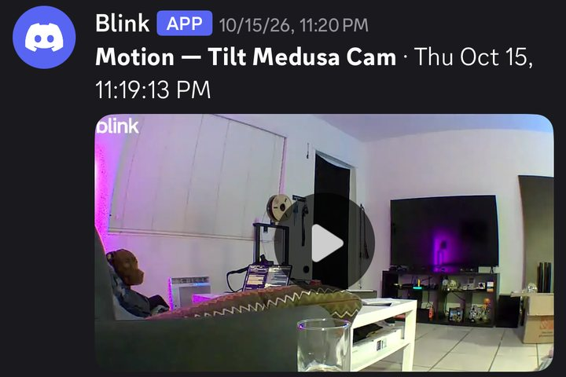
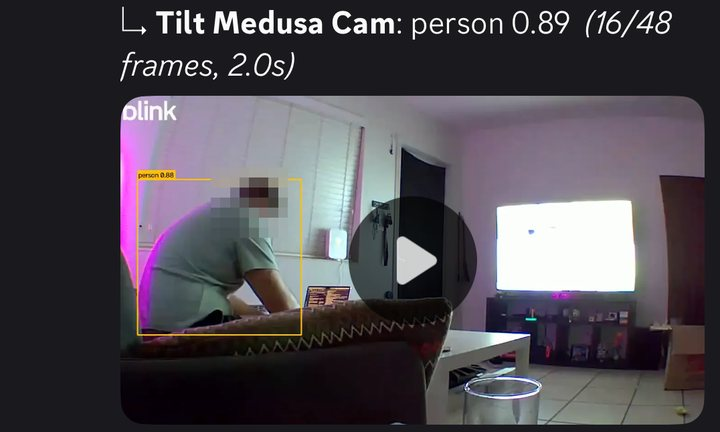
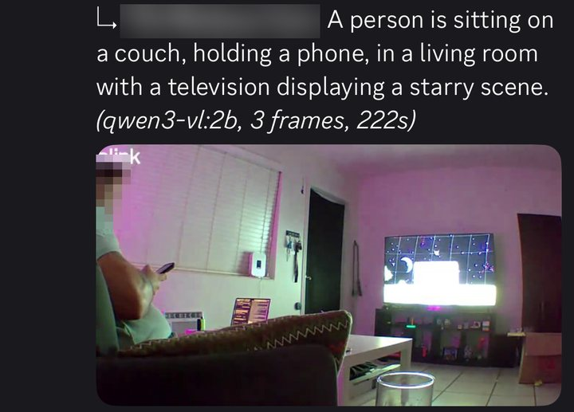
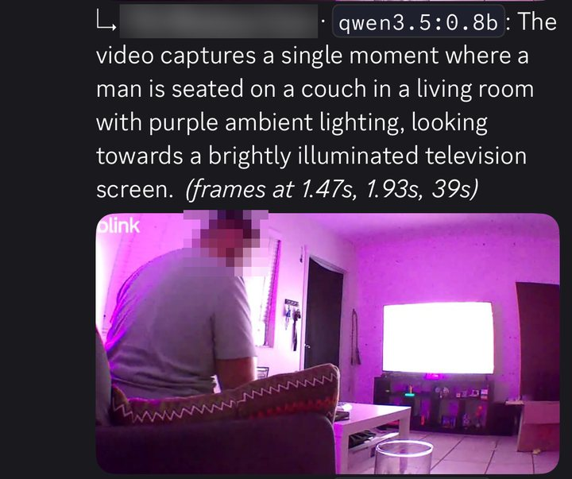
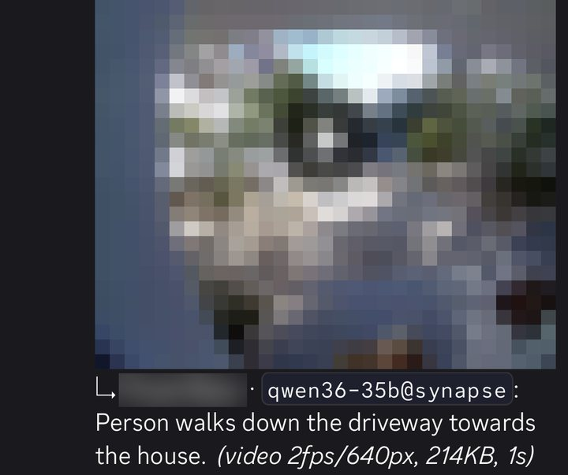

# Homelab

A three-node homelab run as infrastructure-as-config: an always-on Dell OptiPlex
7050 Micro holding every piece of state, a Raspberry Pi as the independent
alerting node and front door, and a dual-GPU Threadripper serving a local 35B
model and a contained AI agent. All inter-node traffic runs over Tailscale;
nothing is exposed to the LAN or the public internet.

The point of the project is not the hardware. It is that every node is assigned
work it is actually suited to, every container is capacity-bounded, nothing that
matters depends on the least reliable thing it touches, and the monitoring is
designed around the assumption that any given node will fail — including the
node doing the monitoring.

---

## Architecture

|  | sentinel — Pi | forge — OptiPlex | synapse — Threadripper |
|---|---|---|---|
| **Hardware** | Raspberry Pi, microSD | i7-7700T (35W), 16GB, NVMe | 9960X, 2× RTX 5070 Ti 16GB, 32GB |
| **Job** | Alerting, front door | All state, metrics | Inference, agent |
| **Failure mode** | SD card death | OOM, disk fill | GPUs on another job |
| **Trusted with** | Saying something is wrong | Anything that must survive a reboot | Work that can be skipped |

### Why the work is split this way

**forge holds anything that must survive a reboot.** Databases, the queue
broker, bookkeeping, metrics history and the camera archive. It is the box with
the real availability guarantee and fast local storage, so it is the only node
trusted with state.

**sentinel exists to watch the others.** ~5W, separate power, separate storage,
separate failure modes — so when forge falls over, the thing that says so is
not part of the outage (ADR-0001). The service dashboard lives here too: a
front door that dies with the box it points at is not useful.

**synapse does the GPU work, and nothing critical waits on it.** It serves the
agent's model and enriches other pipelines, but it is treated as optional: it
gets torn down for benchmarking, and its GPUs get lent to other projects. Every
consumer is built so that synapse being down costs a feature, never an alert.


---

## What is running

| Node | Role | Component |
|---|---|---|
| sentinel | Uptime monitoring and alerting | Uptime Kuma |
| sentinel | Service dashboard (sees all nodes) | Homepage |
| forge | Metrics and dashboards | Prometheus, Grafana, node-exporter, cAdvisor |
| forge | Relational database, queue broker | PostgreSQL with pgAdmin, Redis |
| forge | Double-entry bookkeeping | Manager.io |
| forge | Camera ingest, archive, alerts | blink-watch + detector (custom) |
| forge | Boot-time self-repair | docker-port-healer (systemd) |
| synapse | Local inference | vLLM — Qwen3.6-35B-A3B, NVFP4, 2-GPU |
| synapse | AI agent (Discord) | Hermes Agent |
| synapse | Agent egress allowlist, search | Squid, SearXNG |
| forge, synapse | Read-only Docker API for the dashboard | docker-socket-proxy |

Each node runs its own Portainer; services address each other by Tailscale name.

---

## Project — Blink smart alerts

Blink's cameras record to a USB drive on the Sync Module for free, but anything
smarter than "motion happened" sits behind a subscription. This pipeline pulls
each clip off the module, archives it on forge, alerts on Discord, and then has
the local model on synapse describe what is in it — a one-line push
notification like "Delivery driver leaves a package at the front door."

### How a clip moves

1. **Ingest on forge.** A watcher polls the Sync Module's local-storage manifest
   through `blinkpy`, downloads each new clip, and files it as camera / date /
   time with a JSON sidecar recording every timing.
2. **Alert immediately.** The raw clip is posted to Discord the moment it lands.
   **The alert never waits on AI** — that is the one hard constraint.
3. **Describe in the background.** A detector service re-encodes the clip small
   (2 fps, 640px, no audio — bounds tokens per clip and drops a broken first
   packet Blink writes) and sends the whole clip, as video, to vLLM on synapse.
4. **Follow up.** The one-sentence description posts as a reply under the alert
   and is written into the sidecar. If synapse is down, the clip still saves and
   still alerts — it just gets no description. No fallback, by choice.

### How it got there — three designs in two days

- **Object detection first.** YOLO26n through ONNX Runtime on two of forge's CPU
  threads, posting a copy of the clip with boxes drawn. It proved the plumbing,
  but a boxed video on a phone answers nothing a sentence does not answer faster.
- **Then small vision models on forge's CPU.** 0.8B–2B VLMs, single frames, then
  three frames chained with notes carried between them. Accurate enough, but
  39–224 seconds per clip on a 35W quad-core.
- **Then the cheapest option, checked last when it should have been first:** the
  35B model synapse already serves for the agent accepts video natively; vision
  had simply been switched off at launch. Turning it on cost nothing measurable
  (agent throughput 238 vs 240 tok/s, same reasoning and retrieval scores,
  roughly the same VRAM), and the first real clip was described in **2.6
  seconds**.

The same Discord channel across all four stages, cropped, with faces, camera names and the
exterior view pixelated. Each reply's footer gives the model, frames and time.

| 1 · Raw clip | 2 · YOLO26n on CPU — 2.0s | 3 · 2B VLM on CPU — 222s | 4 · 0.8B, chained — 39s | 5 · 35B on synapse — 1s |
|---|---|---|---|---|
|  |  |  |  |  |

### Bugs worth keeping

- **Blink lies about frame rate.** Frame-index arithmetic put second 3 of a
  10-second clip past the end of the file. Frames are now picked by real
  presentation timestamp.
- **New cameras were silently dropped.** The library learns camera names once at
  startup. Unknown cameras are now accepted and trigger a re-read of the camera
  list from the cloud.
- **Renaming a camera re-posted its entire history.** Seen-clip keys included the
  camera name; they now key on recording time, and anything older than an hour
  is marked seen rather than posted.
- **Polling made the app say "system busy".** Every manifest poll is a command
  the Sync Module must process. A 48-hour probe logged every read-only cloud
  endpoint on change and scored each field's precision and recall against real
  clips, to find a cloud-side motion signal that can gate the poll. Choosing the
  trigger from that data is the open step.
- **A login storm.** A fatal error under `restart: unless-stopped` re-logged into
  Blink every second. Fatal paths now back off ten minutes before exiting.

### Tradeoffs, stated plainly

Latency is minutes, not seconds. Clips transit Blink's cloud on the way down, so
this is not fully local. The API is unofficial and one read uses a private
library attribute, so the library is pinned to a known commit. The YOLO stack is
AGPL. The archive is a single copy with no retention policy yet.

### v2 — a Pi Zero 2 W where the USB drive was

**Designed, not built. One unverified assumption decides whether it works at all.**

Most of v1's problems come from one fact: the clips sit on a drive only the Sync
Module can read, so every clip has to be asked for through Blink's cloud. v2
removes that. A Raspberry Pi Zero 2 W plugs into the Sync Module's USB port and
presents itself as a USB drive (Linux USB gadget mode), backed by a disk image
on the Pi's own storage. The Sync Module records to it as it does to any drive,
and the Blink app keeps working. But the Pi can see each file the moment it is
written, and send it to forge over Tailscale. The Pi keeps nothing: it forwards
clips and keeps only a short buffer.

| v1 problem | What v2 changes |
|---|---|
| Latency is minutes | No upload round-trip. Seconds after the clip is closed, bounded by how often the Pi re-reads the drive. |
| Clips transit Blink's cloud | Clips go from the camera to the Sync Module, then the Pi, then forge. Fully local. |
| Polling makes the app say "system busy" | No commands are sent to the Sync Module at all. The cloud-trigger probe becomes unnecessary. |
| Unofficial API, private attribute, pinned library | No Blink account in the ingest path. No login, no tokens, no 2FA. |
| New or renamed cameras | Depends on how the module names files on the drive. Unknown until it is looked at. |
| Single-copy archive | Unchanged. That is the backups work, not this. |

**Checked before anything is bought, in this order:**

- **Are the clips readable on the drive?** Blink's documentation suggests clips
  stored on the drive cannot be played on a computer, which would mean they are
  encrypted. If so, v2 does not work as designed and v1 stays. This is a
  10-minute test: copy a few clips off the current drive and try to open them.
- **Reading a drive someone else is writing.** In gadget mode the Sync Module
  owns the filesystem, and the Pi reading the same image underneath it can see
  half-written or stale data. The usual approach is a read-only mount refreshed
  on a short interval, only taking files that have stopped growing.
- **Power.** The Pi running Wi-Fi may draw more than the Sync Module's USB port
  supplies. A separate power supply is likely.
- **SD wear.** Continuous video writes to a microSD card; use a high-endurance
  card and treat the Pi as disposable.

Cost is roughly a Pi Zero 2 W and a card. Under the spend rule it fixes faults
that exist now, so it would pass, but only after the first check comes back
clean.

| Stage | State |
|---|---|
| Clip ingest, archive, Discord alert | Running |
| Descriptions from synapse's vLLM | Running |
| Cloud-side motion trigger to replace polling | Analysing probe |
| v2: Pi Zero 2 W as the drive, fully local | Verify clip format first |
| Filter alerts (e.g. people only) | After a trust period |
| Archive to a NAS | When the NAS exists |
| Home Assistant reading the same archive | Later |

---

## Local AI — synapse

A fully local agent on a fully local model, reachable over Discord, with web
search and no paid APIs in the steady state.

- **Inference:** vLLM serving Qwen3.6-35B-A3B at NVFP4, tensor-parallel across
  both 16GB cards, 262K context, vision enabled. Chosen over a dense 27B after a
  benchmark tied them on reasoning and tool use at 238 vs ~102 tok/s and 262K vs
  ~88K context.
- **Tuned from failures, not defaults.** The speculative-decoding draft head
  OOM-crashed vLLM twice, so it is off. Automatic KV-cache sizing left ~76MB free
  per card, so the cache is a fixed size with real headroom. Prefix caching
  caused long-prompt hangs on this hybrid architecture, so it is off.
- **Agent:** Hermes Agent in a container — non-root, no Docker socket,
  `no-new-privileges`, 4GB and 512-PID limits. Only allowlisted Discord users can
  command it, and memory or skill writes need explicit approval.

Both cards, captured between requests. vLLM's two tensor-parallel workers hold
15.6 of 16.3GB each, the 95% budget it is configured for, reserved up front:

```
$ nvidia-smi
Thu Oct 22 02:41:34 2026
+-----------------------------------------------------------------------------------------+
| NVIDIA-SMI 595.91.07              Driver Version: 595.91.07      CUDA Version: 13.2     |
+-----------------------------------------+------------------------+----------------------+
| GPU  Name                 Persistence-M | Bus-Id          Disp.A | Volatile Uncorr. ECC |
| Fan  Temp   Perf          Pwr:Usage/Cap |           Memory-Usage | GPU-Util  Compute M. |
|                                         |                        |               MIG M. |
|=========================================+========================+======================|
|   0  NVIDIA GeForce RTX 5070 Ti     Off |   00000000:81:00.0 Off |                  N/A |
|  0%   31C    P8              9W /  300W |   15612MiB /  16303MiB |      0%      Default |
|                                         |                        |                  N/A |
+-----------------------------------------+------------------------+----------------------+
|   1  NVIDIA GeForce RTX 5070 Ti     Off |   00000000:C1:00.0 Off |                  N/A |
|  0%   30C    P8              8W /  300W |   15612MiB /  16303MiB |      0%      Default |
|                                         |                        |                  N/A |
+-----------------------------------------+------------------------+----------------------+

+-----------------------------------------------------------------------------------------+
| Processes:                                                                              |
|  GPU   GI   CI              PID   Type   Process name                        GPU Memory |
|        ID   ID                                                               Usage      |
|=========================================================================================|
|    0   N/A  N/A          192195      C   VLLM::Worker_TP0                      15602MiB |
|    1   N/A  N/A          192196      C   VLLM::Worker_TP1                      15602MiB |
+-----------------------------------------------------------------------------------------+
```

### Containment is the network, not the tooling

The agent sits on a Docker network created `--internal`: no gateway, no NAT, no
route off the box. Squid and SearXNG are the only containers on both that
network and an uplink, so they are the only exits, and Squid allows HTTPS to
Discord and five exact GitHub hosts — nothing else. Dropping a proxy setting
costs the agent its egress instead of granting it free egress. The dashboard's
read-only Docker API is deliberately off the agent's network, verified
unreachable three ways.

**Residual risks:** the Discord token is readable inside the agent's container;
the shell tool can write anywhere in the container, so the container is the
sandbox; fetched URLs and search queries are small exfiltration channels; and
the model API is open to every tailnet device without a key.

**Next phase, not running yet:** Hermes takes a scoped task, works on a branch
and opens a pull request — never pushing to `main` — and Claude Code reviews it.
Waiting on a fine-grained token limited to selected repositories.

---

## Operational practice

- **Every container has a `mem_limit`.** The camera detector is additionally
  capped at two CPU threads so a burst of clips cannot starve the databases.
- **Versions are pinned where a rebuild depends on them** — the inference
  server, the metrics stack, the egress proxy, the camera library. Several web
  front-ends and the agent image still track `latest`; a known gap, not a policy.
- **Config is bind-mounted, state lives in named volumes.** The repo plus a
  Tailscale login is the rebuild path.
- **Reachability is a firewall property, not a bind-address property.**
- **Services address each other by Tailscale MagicDNS name, not IP**, with names
  set explicitly at join time so they cannot silently drift from the configs.
- **Secrets never reach the repository.** `.env` is gitignored, `.env.example`
  documents every variable, and `gitleaks` runs before every push.
- **Agents propose, a human executes.** Destructive commands and deployments
  stay human-gated.

---

## Network security model

- **Tailscale is the only transport between nodes.** No port forwarding, no
  public reverse proxy, no public ingress. The camera pipeline is outbound-only.
- **Access is authenticated per device, not per network.**
- **The firewall is the enforcement boundary.** `DOCKER-USER` rules admit only
  traffic arriving over the Tailscale interface; host SSH is restricted the same
  way via UFW.
- **The dashboard never gets a raw Docker socket** — only a read-only proxy.
- **The agent is contained by topology** — see Local AI above.

### Closing a real gap: Docker's firewall bypass

Auditing the tailnet-only property showed published container ports were
reachable from the LAN. Publishing a port inserts iptables rules evaluated
*before* the chain UFW manages, so UFW reports the host as locked down while
Docker has already accepted the traffic — a system that reports itself as closed
while it is open. The fix moved enforcement into the `DOCKER-USER` chain. The
tradeoff: enforcement is now a single control rather than layered, so the
firewall rules are load-bearing. Recorded as ADR-0002, with a runbook whose
verification must be run from a LAN host that is not on the tailnet.

Planned hardening: single sign-on and tailnet ACLs — which would also close the
keyless model API.

---

## Architecture decisions

ADRs are written when the decision is made, and amended or superseded in place
when they stop being true.

- **ADR-0001 — alerting must not share a failure domain with what it watches.**
  Uptime Kuma moved to the Pi. Prometheus and Grafana went there briefly and came
  back: the argument was always about notification, not diagnosis.
- **ADR-0002 — reachability is enforced in the firewall.**
- **ADR-0003 — contain an agent at the network layer.** Written for an earlier
  runtime and superseded, but its reasoning is exactly what synapse runs today.
- **ADR-0004 — built-in agent memory over a vector database.** The plan's premise
  was wrong on every point; the vector store held zero rows for its entire life
  while the built-in hybrid search did the work.
- **ADR-0005 — split runtimes by trust zone, then collapse back to one.** Amended
  when the second runtime proved redundant, including the parts of its security
  section that were never built.
- **Building synapse was not justified by the spend rule, and that is written
  down** rather than treated as though the rule passed.
- **The camera pipeline puts ingest on forge and AI on synapse.** Clips are state;
  descriptions are enrichment.

---

## Migrations and incidents

- **The drive fell asleep and took the filesystem with it.** Every Uptime Kuma
  monitor pointed at forge went red at once, except one. The NVMe drive's power
  saving let it drop into its deepest sleep state, and it came back read-only:
  anything that touched the disk failed. The one green monitor was watching a
  process running entirely from memory, with no disk I/O. A power cycle brought
  the drive back, and a custom rule now keeps it out of that deep sleep state.
  A green check proves only the path it exercised.
- **A power surge broke every published port — the services were fine.** After
  an unclean shutdown, containers restored with correct port config but no live
  mappings. Docker's network state is not crash-safe, and only recreating the
  container rebuilds it. Fixed with a boot-time healer that recreates only
  containers whose bindings are configured but not live — a no-op on a clean
  boot.
- **Built the GPU node and moved inference onto it** — the agent's model now
  runs locally, with hosted APIs out of the steady state.
- **Agent runtime, three reversals**, ending at one local agent on synapse; the
  removed runtime's config was deleted rather than left behind.
- **Uptime Kuma and Homepage → Pi**, per ADR-0001 — a volume copy, not a rewrite.
- **Docker firewall lockdown** (ADR-0002).
- **Removed a container that did nothing** — a worker tailing `/dev/null`
  against a directory that never existed in git.
- **OptiPlex board replacement and 8→16GB RAM upgrade.**
- **Monitoring rollout** with Prometheus recording rules sized for the
  dashboard's URL-encoded queries.

---

## Build status

**Running now.** Three-node split with workloads placed by node reliability.
Tailscale-only mesh enforced in the firewall. Independent alerting and dashboard
on the Pi. Stateful stack, metrics and bookkeeping on forge with boot-time port
self-repair. Local 35B inference and a network-contained agent on synapse. Blink
camera alerts with AI descriptions. ADR practice and secret scanning on every
push.

**In progress.** Choosing a cloud-side motion trigger from the 48-hour probe
data. Agent-opens-PR, Claude-reviews workflow. Pinning the images that still
track `latest`.

**Next.** **Data backups** — the largest unaddressed risk; designed as
peer-to-peer nightly snapshots with quarterly restore tests. Then DNS filtering,
single sign-on and tailnet ACLs, a fully local Blink v2 on a Pi Zero 2 W,
people-only camera alerts, and a NAS.

---

## Note on scope

This is the public view. The configuration itself, runbooks, network
addressing, port bindings and firewall rules live in a separate private
repository.
